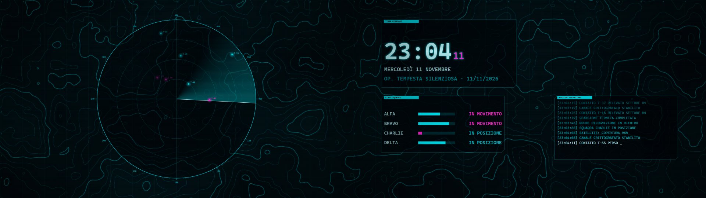
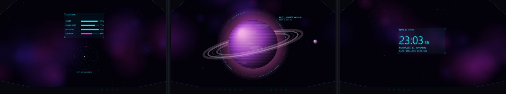

# 🎮 Sfondi Gaming per Lively

Sfondi **animati** a tema gaming per il desktop di **Windows**, da usare con [Lively Wallpaper](https://www.rocksdanister.com/lively/) (gratuito e open source).

- 4 sfondi: **cyberpunk, sci-fi, fantasy e tattico**
- Funzionano su **1, 2 o 3 schermi**, e su più monitor nessun elemento importante finisce sotto le cornici
- **4 palette** (Neon, Notturno, Pastello, Mono) e **3 velocità** (Lento, Medio, Dinamico)
- Alcuni sfondi reagiscono alla **musica** e al **mouse**
- Leggeri: niente video, solo codice. Lively li mette in pausa quando giochi a schermo intero

👉 **[Galleria con demo live](https://Wide97.github.io/sfondi-gaming-lively/)** · **[Scarica gli sfondi](https://github.com/Wide97/sfondi-gaming-lively/releases/latest)**


---

## Gli sfondi

| | Sfondo | Cosa fa | Extra |
|---|---|---|---|
|  | **Neon City**<br>_Cyberpunk_ | Skyline notturna su 3 livelli di parallasse, pioggia, insegne al neon che sfarfallano, auto volanti | 🎵 musica · 🕒 orologio al neon · 🌧️ pioggia |
|  | **Ponte di Comando**<br>_Sci-fi_ | Vista dalla plancia di un'astronave: gigante gassoso con anelli, luna in orbita, nebulosa, HUD olografico | 🖱️ parallasse · 🕒 orologio di bordo · 🛸 cornice |
|  | **Portale Arcano**<br>_Fantasy / RPG_ | Cerchi di rune rotanti, vortice di energia, cristalli sospesi, lucciole | 🖱️ scintille · 🎵 musica · 🕒 orologio |
|  | **Radar Tattico**<br>_FPS / Tattico_ | Radar con fascio rotante su mappa topografica, stato squadra, registro operazioni | 🖱️ mirino che aggancia i bersagli · 🕒 timer missione · ⚡ glitch |

### Le 4 palette

| Neon | Notturno | Pastello | Mono |
|---|---|---|---|
|  |  |  |  |
|  |  |  |  |

---

## Installazione

1. **Installa Lively Wallpaper**, dal [Microsoft Store](https://apps.microsoft.com/detail/9ntm2qc6qws7) oppure da terminale:
   ```
   winget install rocksdanister.LivelyWallpaper
   ```
2. **Scarica lo sfondo**: vai su [Releases](https://github.com/Wide97/sfondi-gaming-lively/releases/latest) e scarica lo `.zip` che ti interessa (ad esempio `neon-city.zip`).
3. **Importalo in Lively**: trascina lo `.zip` nella finestra di Lively, oppure usa il pulsante **+** (Aggiungi sfondo) e selezionalo.
4. **Applicalo**: clicca sulla miniatura dello sfondo nella libreria di Lively.

## Personalizzazione

Nella libreria di Lively, clicca con il tasto destro sullo sfondo e scegli **Personalizza**. Le modifiche si vedono subito.

| Opzione | Valori | Note |
|---|---|---|
| Velocità | Lento · Medio · Dinamico | quanto si muove tutto |
| Palette colori | Neon · Notturno · Pastello · Mono | |
| Schermi | Automatico · 1 · 2 · 3 | vedi sotto |
| Orologio | sì / no | ogni sfondo ha il suo stile |
| Mouse / Musica | sì / no | solo negli sfondi che li supportano |
| Fotogrammi al secondo | 30 · 60 | 30 consuma meno, utile sui portatili |

## 🖥️🖥️🖥️ Su 2 o 3 schermi

1. In Lively apri la scelta dello schermo / disposizione e seleziona **Span** (estendi un solo sfondo su tutti i monitor).
2. Applica lo sfondo. Con l'opzione **Schermi = Automatico** lo sfondo capisce dalle proporzioni quanti monitor hai:
   - 16:9 → 1 schermo
   - 32:9 → 2 schermi
   - 48:9 → 3 schermi

   Se hai monitor ultrawide o con risoluzioni diverse, imposta il numero a mano.

Come si dispone la scena:

| Schermi | Disposizione |
|---|---|
| **1** | L'elemento principale è al centro, orologio e pannelli intorno |
| **2** | Al centro c'è la cornice tra i monitor, quindi lì non c'è niente: ogni schermo ha il suo punto di interesse (ad esempio radar a sinistra, pannelli e orologio a destra) |
| **3** | L'elemento principale sta sullo schermo centrale, quelli laterali fanno da contorno |

**2 schermi**


**3 schermi**



> 💡 Preferisci uno sfondo diverso per ogni monitor? Usa in Lively la disposizione **Per schermo** e imposta **Schermi = 1 schermo** su ciascuno.

## Mouse e musica

- **Mouse**: Ponte di Comando, Portale Arcano e Radar Tattico reagiscono al cursore. Controlla che nelle impostazioni di Lively l'input del mouse sullo sfondo sia attivo.
- **Musica**: Neon City e Portale Arcano si muovono a tempo con l'audio del PC. Lively passa l'audio da solo, non serve configurare nulla.

## Prestazioni

- Lively mette in **pausa** lo sfondo quando c'è un gioco o un'app a schermo intero.
- Le parti statiche della scena vengono disegnate una volta sola: a ogni fotogramma si ridisegna solo quello che si muove.
- Sui portatili imposta **30 FPS** e la velocità **Lento**.

---

## Per sviluppatori

```
sfondi-gaming-lively/
├─ wallpapers/<nome>/
│  ├─ index.html              carica kit.js + main.js
│  ├─ main.js                 la scena (canvas 2D)
│  ├─ LivelyInfo.json         titolo, descrizione, tipo (1 = web, 2 = web con audio)
│  ├─ LivelyProperties.json   le opzioni di "Personalizza"
│  └─ thumbnail.jpg
├─ shared/kit.js              base comune: proprietà, palette, velocità, multi-schermo, audio, mouse
├─ docs/                      galleria GitHub Pages + immagini
├─ scripts/
│  ├─ anteprime.mjs           rigenera le anteprime con Edge headless
│  └─ pacchetti.mjs           prepara dist/ (pacchetti Lively + sito)
└─ .github/workflows/         a ogni push aggiorna il sito, a ogni tag v* crea la release con gli .zip
```

**Provare uno sfondo nel browser**: apri `wallpapers/<nome>/index.html`. Le opzioni si possono passare nell'URL, ad esempio `index.html?palette=2&velocita=0&schermi=1`.

**Rigenerare le anteprime** (Windows con Edge e Node 18+):
```
node scripts/anteprime.mjs
```

**Pubblicare una nuova versione**:
```
git tag v1.1.0
git push --tags
```

**Aggiungere uno sfondo**: copia una cartella in `wallpapers/`, scrivi la scena in `main.js` con `Kit.start({ palettes, defaults, build, draw })` e usa `Kit.layout()` per posizionare gli elementi per 1, 2 o 3 schermi.

## Licenza

[MIT](LICENSE): usali, modificali e condividili liberamente.
