# 🎮 Sfondi Gaming per Lively

Sfondi **animati** a tema gaming per il desktop di **Windows**, da usare con [Lively Wallpaper](https://www.rocksdanister.com/lively/) (gratuito e open source).

- 7 sfondi: **cyberpunk, sci-fi, fantasy, tattico**, una **notte rossonera in curva** e due sfondi **soft con informazioni utili** (meteo, calendario, PC, musica)
- Funzionano su **1 schermo, 2 affiancati o 3 a L**: la scena scorre da un monitor all'altro verso quello principale
- **4 palette** (Neon, Notturno, Pastello, Mono) e **3 velocità** (Lento, Medio, Dinamico)
- **3 intensità** (Calmo, Equilibrato, Vivace): con **Calmo**, il predefinito, le icone del desktop restano leggibili
- Alcuni sfondi reagiscono alla **musica** e al **mouse**
- Leggeri: niente video, solo codice. Lively li mette in pausa quando giochi a schermo intero

👉 **[Galleria con demo live](https://Wide97.github.io/sfondi-gaming-lively/)** · **[Scarica gli sfondi](https://github.com/Wide97/sfondi-gaming-lively/releases/latest)**

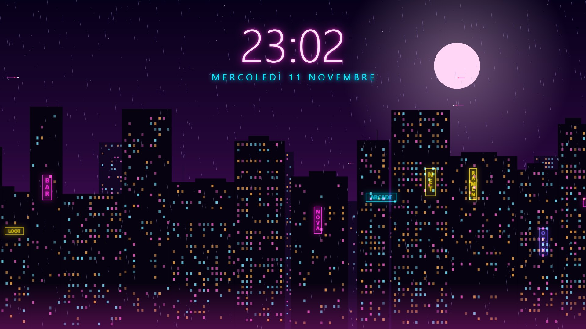

---

## Gli sfondi

| | Sfondo | Cosa fa | Extra |
|---|---|---|---|
|  | **Neon City**<br>_Cyberpunk_ | Skyline notturna su 3 livelli di parallasse, pioggia, insegne al neon che sfarfallano, auto volanti | 🎵 musica · 🕒 orologio al neon · 🌧️ pioggia |
| 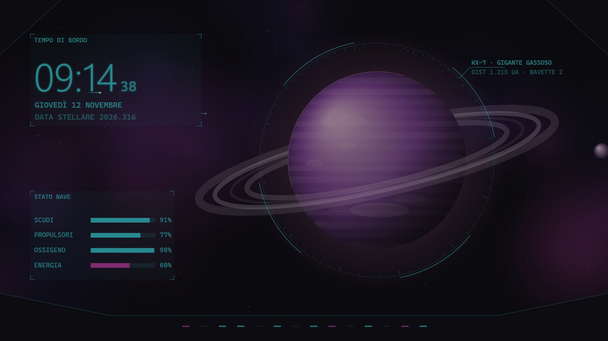 | **Ponte di Comando**<br>_Sci-fi_ | Vista dalla plancia di un'astronave: gigante gassoso con anelli, luna in orbita, nebulosa, HUD olografico | 🖱️ parallasse · 🕒 orologio di bordo · 🛸 cornice |
| 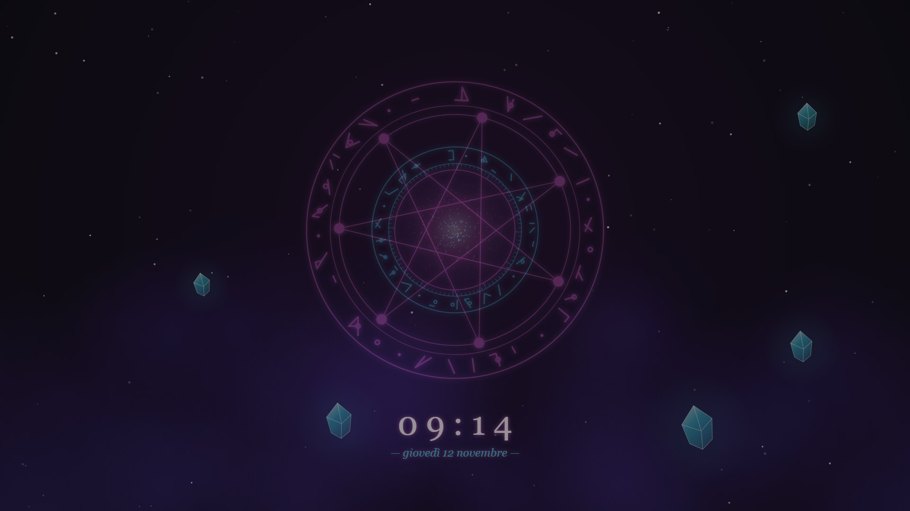 | **Portale Arcano**<br>_Fantasy / RPG_ | Cerchi di rune rotanti, vortice di energia, cristalli sospesi, lucciole | 🖱️ scintille · 🎵 musica · 🕒 orologio |
| 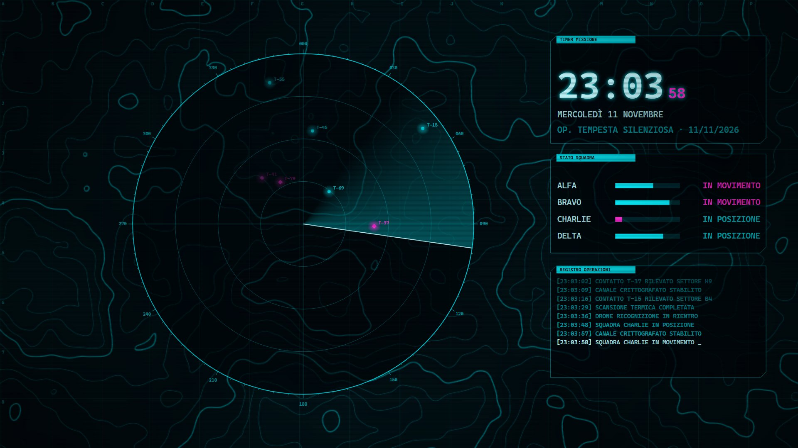 | **Radar Tattico**<br>_FPS / Tattico_ | Radar con fascio rotante su mappa topografica, stato squadra, registro operazioni | 🖱️ mirino che aggancia i bersagli · 🕒 timer missione · ⚡ glitch |
| 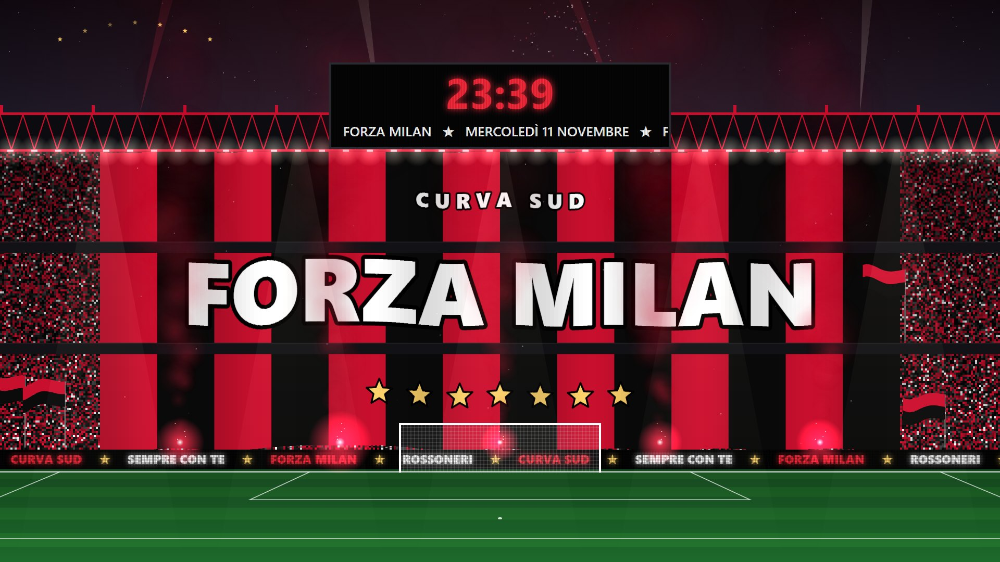 | **Rossoneri**<br>_Calcio · Curva Sud_ | Notte di stadio: coreografia rossonera con sette stelle, bandiere, fumogeni, la ola, fuochi d'artificio. Palette: Rossonero, Notte di Coppa, Trasferta, Oro | ✍️ scritta personalizzabile · 🛡️ immagine tua al centro · 🖱️ fuochi al clic · 🎵 musica · 🕒 tabellone |
| 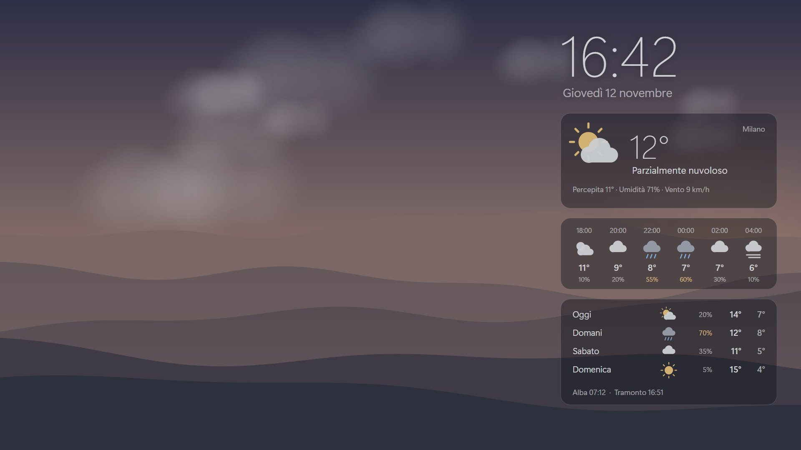 | **Orizzonte**<br>_Soft · Meteo_ | Colline morbide sotto un cielo che segue l'ora vera (alba, giorno, tramonto, notte) e il meteo della tua città: nuvole, pioggia e neve quando ci sono davvero. Palette: Colline, Lago, Dune, Grafite | 🌦️ meteo attuale, prossime ore e giorni · 🌅 alba e tramonto · 🕒 orologio |
| 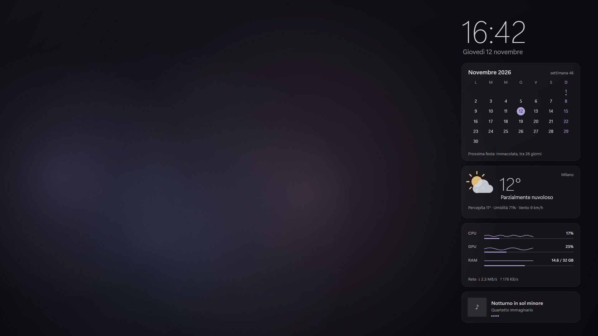 | **Bruma**<br>_Soft · Cruscotto_ | Nebbie di colore che si muovono piano, con un cruscotto discreto. Palette: Lavanda, Salvia, Notte, Sabbia | 📅 calendario con festività · 💻 CPU, GPU, RAM, rete · 🎵 brano in riproduzione · 🌦️ meteo |

> **Rossoneri** è uno sfondo **non ufficiale** fatto da tifosi: non è affiliato né approvato dal club e il pacchetto non contiene stemmi, loghi o marchi ufficiali. Ci sono solo i colori, la scritta della coreografia (modificabile) e l'atmosfera da stadio.
>
> **Immagine al centro della coreografia**: metti un'immagine tua (PNG trasparente ideale) nella cartella `stemma` dello sfondo, che trovi in Lively con tasto destro → *Apri cartella*, poi sceglila in *Personalizza → Stemma*. Resta solo sul tuo PC: non è nel repo né negli zip.

### Le 4 palette

| Neon | Notturno | Pastello | Mono |
|---|---|---|---|
| 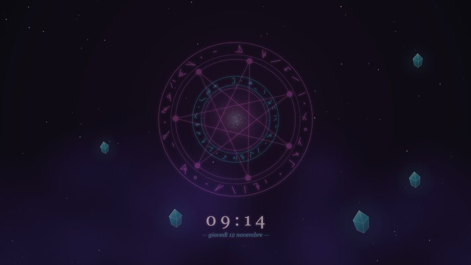 | 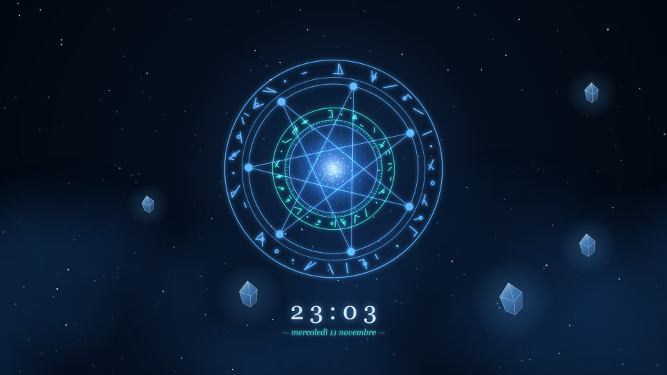 | 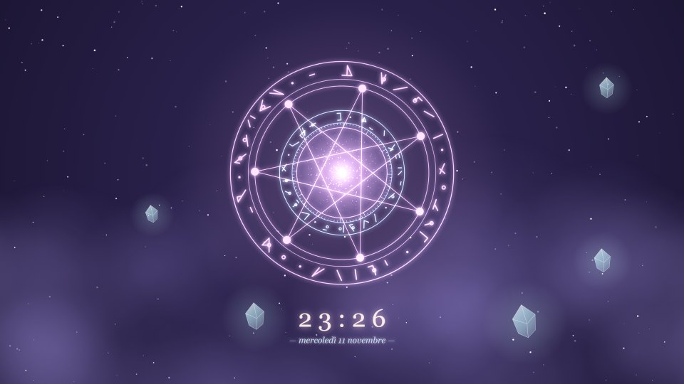 | 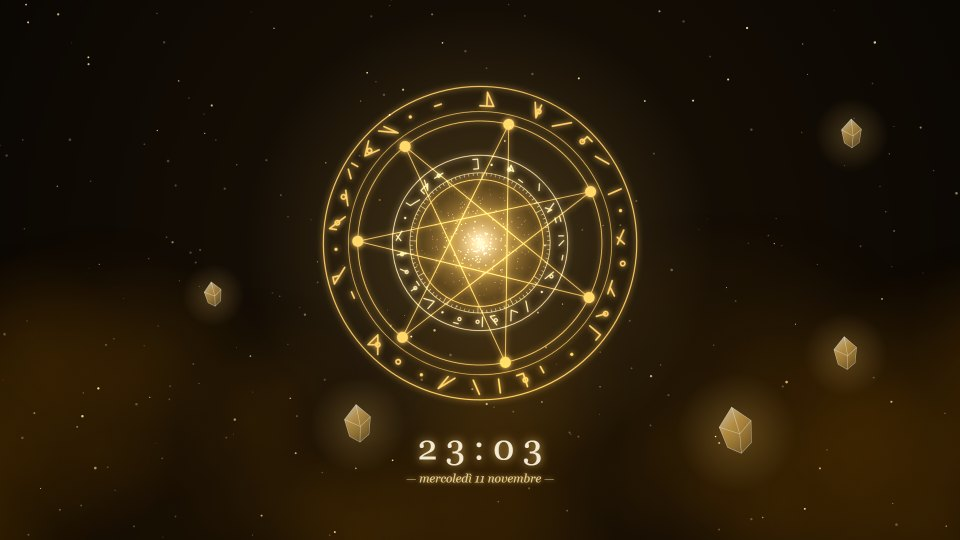 |
| 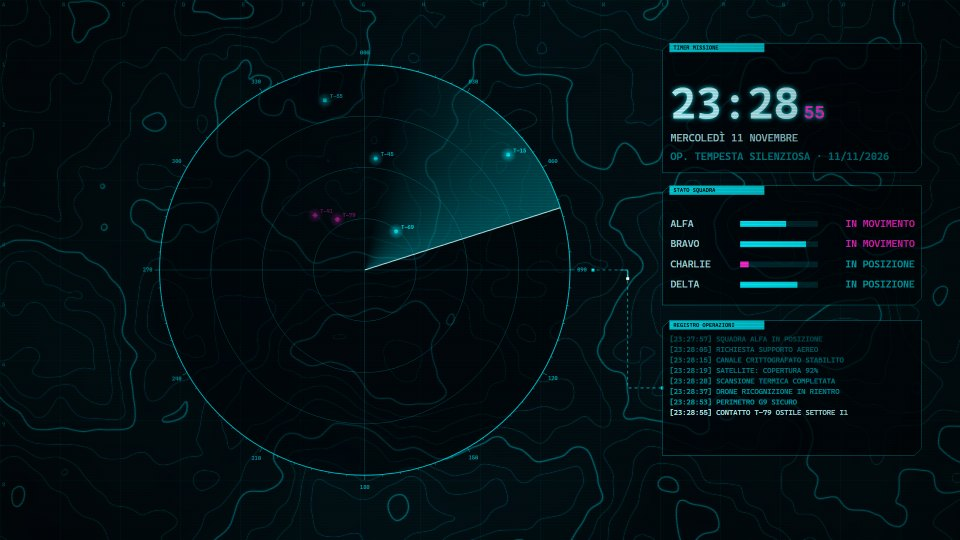 | 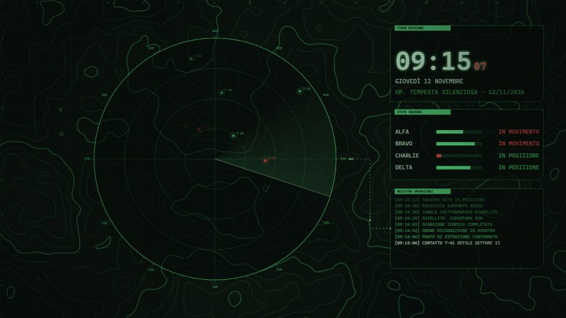 | 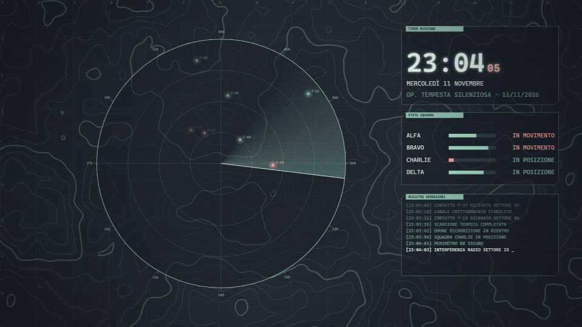 | 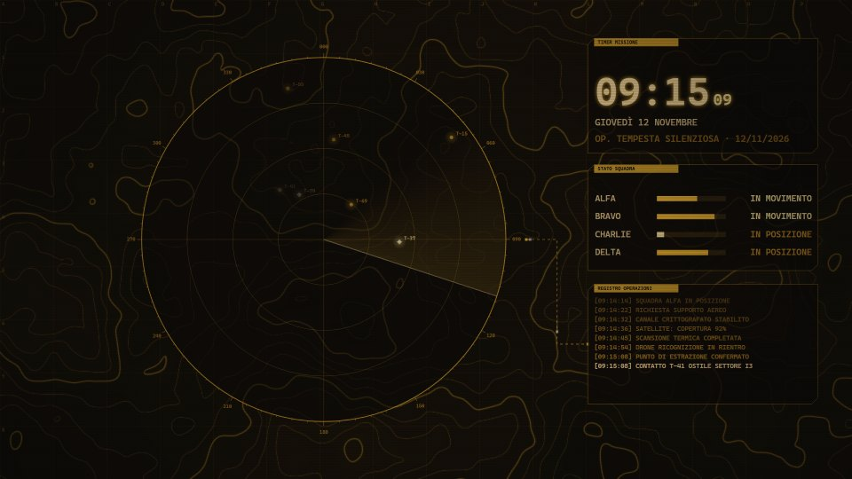 |

---

## Installazione

1. **Installa Lively Wallpaper**, dal [Microsoft Store](https://apps.microsoft.com/detail/9ntm2qc6qws7) oppure da terminale:
   ```
   winget install rocksdanister.LivelyWallpaper
   ```
2. **Scarica lo sfondo**: vai su [Releases](https://github.com/Wide97/sfondi-gaming-lively/releases/latest) e scarica lo `.zip` che ti interessa (ad esempio `neon-city.zip`).
3. **Importalo in Lively**: trascina lo `.zip` nella finestra di Lively, oppure usa il pulsante **+** (Aggiungi sfondo) e selezionalo.
4. **Applicalo**: clicca sulla miniatura dello sfondo nella libreria di Lively.

## Personalizzazione

Nella libreria di Lively, clicca con il tasto destro sullo sfondo e scegli **Personalizza**. Le modifiche si vedono subito.

| Opzione | Valori | Note |
|---|---|---|
| Velocità | Lento · Medio · Dinamico | quanto si muove tutto |
| Intensità | Calmo · Equilibrato · Vivace | Calmo (predefinito) abbassa luci e colori e toglie lampeggi e flash, così le icone si leggono; Vivace è lo stile originale |
| Palette colori | Neon · Notturno · Pastello · Mono | |
| Schermi | Automatico · 1 · 2 affiancati · 3 a L | vedi sotto |
| Orologio | sì / no | ogni sfondo ha il suo stile |
| Mouse / Musica | sì / no | solo negli sfondi che li supportano |
| Fotogrammi al secondo | 30 · 60 | 30 consuma meno, utile sui portatili |

## 🖥️🖥️🖥️ Su 2 o 3 schermi

Gli sfondi sono pensati per queste disposizioni dei monitor:

```
2 schermi affiancati            3 schermi a L              2 uno sopra l'altro

[ secondario ][ PRINCIPALE ]    [ sopra      ]              [ sopra      ]
                                [ PRINCIPALE ][ destra ]   [ PRINCIPALE ]
```

Gli schermi non sono indipendenti: la scena è **una sola** e scorre da un monitor all'altro verso il principale.

| Sfondo | Sul principale | Il flusso tra gli schermi |
|---|---|---|
| **Neon City** | megatorre e orologio al neon | la città, il traffico e la pioggia scorrono verso il principale; con 3 schermi la torre sale fino allo schermo di sopra e gli ascensori di luce la percorrono |
| **Ponte di Comando** | il pianeta | le navette partono dai secondari (con 3 schermi dalla stazione orbitale di sopra) e atterrano sul pianeta; un collegamento dati porta pacchetti dai pannelli al bersaglio; i montanti della cabina coincidono con le cornici dei monitor |
| **Portale Arcano** | il grande portale | su ogni secondario un cerchio di rune manda un fiume di energia dentro il portale; le lucciole salgono da uno schermo all'altro |
| **Radar Tattico** | il radar | ogni contatto rilevato parte come pacchetto dal radar e arriva al registro sul secondario; con 3 schermi un satellite di sopra manda scansioni giù al radar |
| **Rossoneri** | la curva con la coreografia, la porta e il tabellone | la ola e i tabelloni LED a bordo campo scorrono dai secondari verso la curva; con 3 schermi fumo, fasci di luce e fuochi d'artificio salgono nello schermo di sopra |

**Come si attiva:**
1. In Lively scegli la disposizione **Span**, cioè un solo sfondo esteso su tutti i monitor.
2. Applica lo sfondo e in **Personalizza → Schermi** scegli la tua disposizione, oppure lascia **Automatico**: lo sfondo confronta l'area totale con la dimensione di un monitor e la riconosce da solo.

> ℹ️ Con Span, Lively crea un'unica area grande quanto il rettangolo che contiene tutti i monitor. Nella disposizione a L l'angolo in alto a destra non ha nessuno schermo, quindi lì non c'è niente di importante. Gli sfondi danno per scontato che i monitor abbiano la stessa risoluzione e siano allineati.

**2 schermi affiancati** (principale a destra)
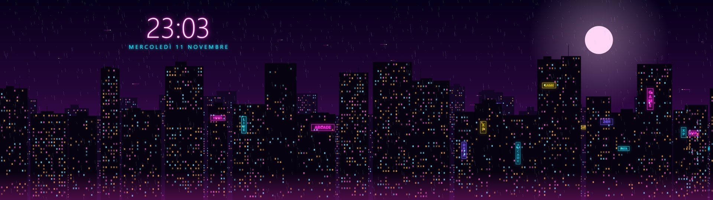
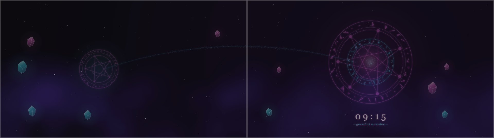

**3 schermi a L** (principale in basso a sinistra, secondo a destra, terzo sopra)
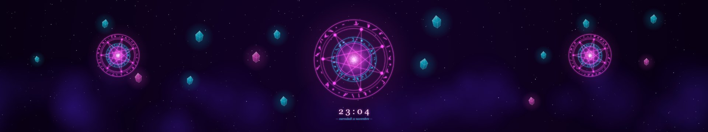
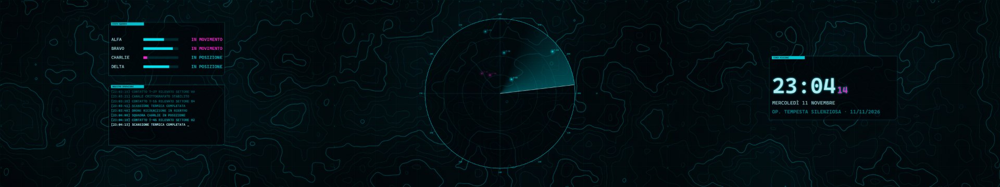
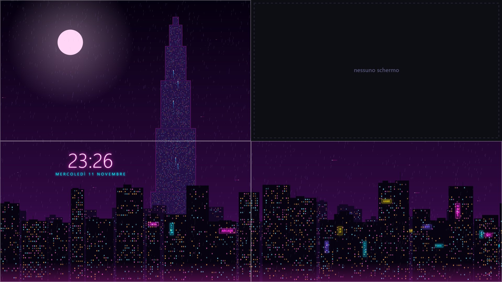
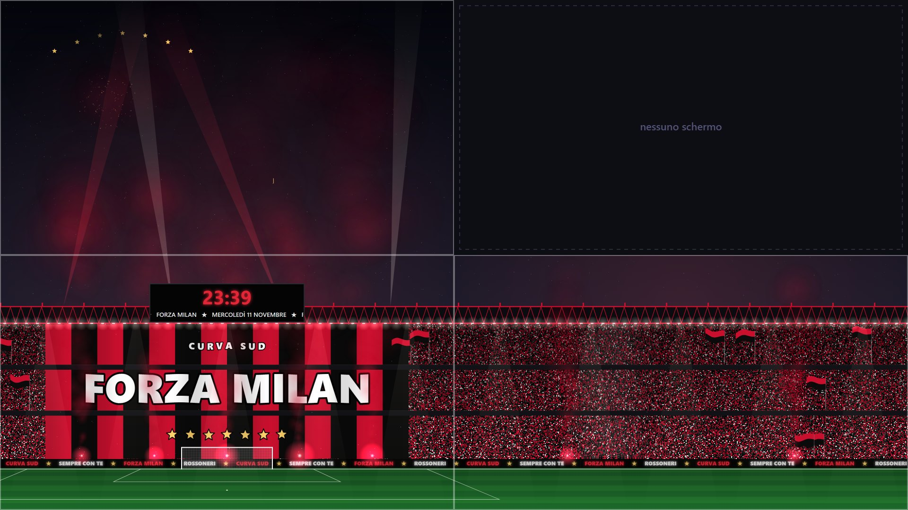

> 💡 Preferisci uno sfondo diverso per ogni monitor? Usa in Lively la disposizione **Per schermo** e imposta **Schermi = 1 schermo** su ciascuno.

## Informazioni utili (Orizzonte e Bruma)

- **Meteo**: scrivi la tua città in *Personalizza → Città*. I dati arrivano da [Open-Meteo](https://open-meteo.com/) (gratis, senza account né chiave): lo sfondo invia solo il nome della città e le sue coordinate, si aggiorna ogni 30 minuti e ricorda l'ultimo dato se sei offline. In Bruma, lasciando la città vuota il meteo non compare.
- **Cielo reale** (Orizzonte): alba e tramonto sono quelli veri della tua città; senza meteo usa 07:00 e 17:30.
- **Calendario** (Bruma): mese corrente, numero della settimana, festività nazionali italiane (Pasqua e Pasquetta comprese) e quanto manca alla prossima.
- **PC e musica** (Bruma): CPU, GPU, RAM e rete, e il brano che stai ascoltando (Spotify, browser e qualunque player che compare nei controlli multimediali di Windows). Li fornisce Lively, il pacchetto li attiva da solo. Nel browser non sono disponibili, e i pannelli che non hanno dati non compaiono.
- **Dove vanno i pannelli**: con 2 o 3 schermi stanno sui secondari, così sul principale restano solo le icone. Con 1 schermo stanno in una colonna a destra.

## Mouse e musica

- **Mouse**: Ponte di Comando, Portale Arcano e Radar Tattico reagiscono al cursore. Controlla che nelle impostazioni di Lively l'input del mouse sullo sfondo sia attivo.
- **Musica**: Neon City e Portale Arcano si muovono a tempo con l'audio del PC. Lively passa l'audio da solo, non serve configurare nulla.

## Prestazioni

- Lively mette in **pausa** lo sfondo quando c'è un gioco o un'app a schermo intero.
- Le parti statiche della scena (palazzi, pubblico, mappa…) vengono preparate una volta sola e a ogni fotogramma vengono solo ricopiate, non ricalcolate.
- Il limite di FPS è reale: con **60** lo sfondo non supera i 60 FPS anche su un monitor a 144 o 180 Hz.
- Sui portatili imposta **30 FPS** e la velocità **Lento**.

---

## Per sviluppatori

```
sfondi-gaming-lively/
├─ wallpapers/<nome>/
│  ├─ index.html              carica kit.js + main.js
│  ├─ main.js                 la scena (canvas 2D)
│  ├─ LivelyInfo.json         titolo, descrizione, tipo (1 = web, 2 = web con audio)
│  ├─ LivelyProperties.json   le opzioni di "Personalizza"
│  └─ thumbnail.jpg
├─ shared/kit.js              base comune: proprietà, palette, velocità, intensità, multi-schermo, audio, mouse
├─ shared/info.js             meteo, calendario, dati di sistema e musica, widget dei pannelli (Orizzonte, Bruma)
├─ docs/                      galleria GitHub Pages (legge catalog.json) + immagini
├─ scripts/
│  ├─ anteprime.mjs           rigenera le anteprime con Edge headless
│  ├─ pacchetti.mjs           prepara dist/ (pacchetti Lively + sito)
│  └─ configura.mjs           unica fonte dei dati: genera i file di Lively, docs/catalog.json e le note di release
└─ .github/workflows/         a ogni push aggiorna il sito, a ogni tag v* crea la release con gli .zip
```

**Provare uno sfondo nel browser**: apri `wallpapers/<nome>/index.html`. Le opzioni si possono passare nell'URL, ad esempio `index.html?palette=2&velocita=0&schermi=1`.

**Rigenerare le anteprime** (Windows con Edge e Node 18+):
```
node scripts/anteprime.mjs
```

**Pubblicare una nuova versione**:
```
git tag v1.1.0
git push --tags
```

**Aggiungere uno sfondo**: aggiungi una voce in `scripts/configura.mjs` e lancialo (aggiorna anche galleria e note di release), scrivi la scena in `main.js` con `Kit.start({ palettes, defaults, build, draw })` e usa `Kit.layout()` per posizionare gli elementi per 1, 2 o 3 schermi. Per l'intensità, definisci una tabella `LIVELLI` con i valori `[calmo, equilibrato, vivace]` e leggili con `Kit.pick(...)`: tieni bassi nel calmo lampeggi, flash e zone molto chiare. Il velo (luminosità e saturazione) lo applica già `kit.js`, e si può personalizzare con `Kit.start({ veil })`.

## Licenza

[MIT](LICENSE): usali, modificali e condividili liberamente.
